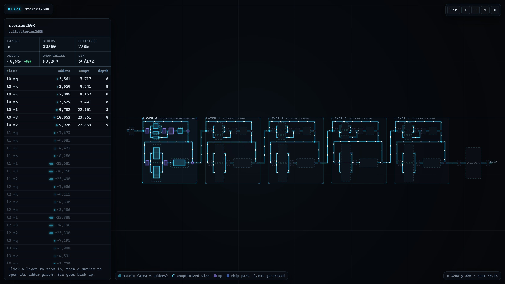
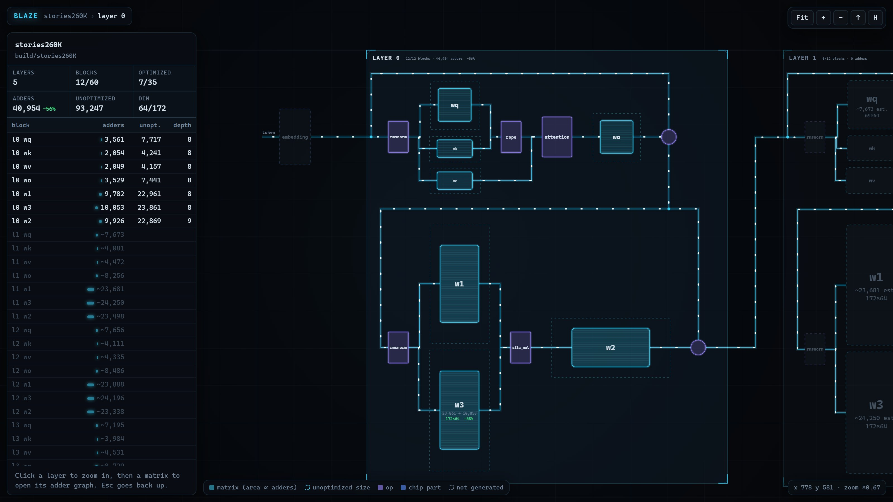
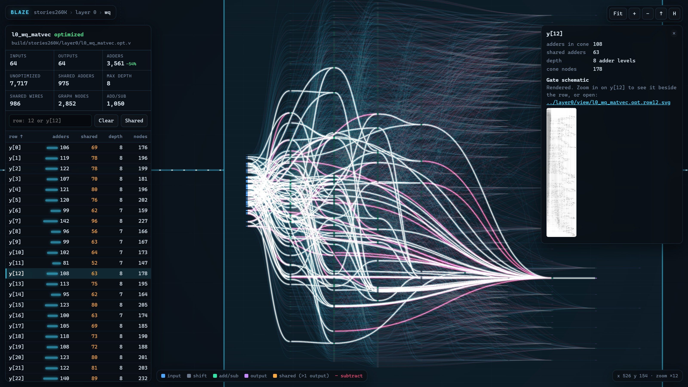
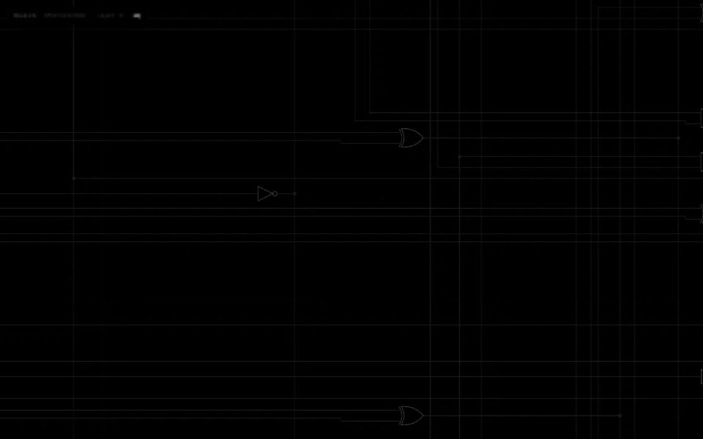

# Circuit viewer

`blaze view` shows the generated model as a chip, and what each matrix block computes, for a person to inspect. It reads the blocks' Verilog (plus, for the workspace, the checkpoint header and weights for placeholder estimates), so it works on any block that `gen-matrix` (or an optimizer that keeps the same module and ports) wrote. Nothing in it changes a block or a pass criterion.

## Chip workspace



```powershell
blaze view --model build/stories260K          # -> build/stories260K/view/stories260K.html
blaze view --model build/stories260K/chip     # the same page
```

This lays out the whole model as one chip on an infinite dark canvas: the embedding, every layer, the final norm, the classifier and argmax, joined by data-flow wires. Each layer has an attention lane (rmsnorm, wq/wk/wv, rope, attention, wo, residual add) above an FFN lane (rmsnorm, w1/w3, silu_mul, w2, residual add), with the residual wires around both.

- **Matrix tiles** have an area proportional to their adder count and get brighter with it. An optimized block (`.opt.v`) is drawn at its optimized size with a dashed outline at its unoptimized size, and its label shows both counts and the saving.
- **Blocks not generated yet** are dim dashed placeholders. Their size comes from gen-matrix's 8-bit adder count for that weight, marked `~... est.`, and clicking one shows the command that generates it. The embedding, final norm, classifier and argmax exist only in `chip/blaze_chip.v`, so they are placeholders until `blaze integrate` has run. The classifier is always gen-matrix at 8 bits, so its count is exact.
- The layer count and matrix shapes come from `--checkpoint` (default `models/<model>/<model>.bin`). Without a readable checkpoint, only the `layer<N>/` directories on disk are laid out, and missing matrices have no estimate.

The left panel has the totals (blocks generated, matrices optimized, adders and unoptimized adders) and a table of every matrix; click a line to fly to it. **H** hides the panels for a clean screen recording.



Drag to pan, scroll or pinch to zoom. Click a layer to zoom into it, then click a matrix to open its adder graph. Zooming is continuous: past a size, a matrix tile fades into its graph. The breadcrumb (`stories260K › layer 0 › wq`) and **Esc** go back up a level, **F** fits the current level, and a link ending in `#layer0` or `#l0_wq_matvec` opens there.

## Adder graph

```powershell
blaze view build/stories260K/layer0/l0_wq_matvec.v        # -> build/stories260K/layer0/view/l0_wq_matvec.html
blaze view build/stories260K/layer0/l0_wq_matvec.opt.v    # -> .../view/l0_wq_matvec.opt.html
```

Given one block file, the page opens straight on that block's graph, the same view as inside the workspace.

The parser reads every `wire ... = expr;` and `assign` statement. Expressions can use n-ary `+`/`-`, unary `-`, constant shifts (`<<`, `<<<`, `>>`, `>>>`), `$signed()`, parentheses, nets, input port bit-selects and integer constants. Anything else stops with an error naming the statement. The graph has five kinds of node:

- **input**: an input slice, named after the wire that sign-extends it (`x_3`).
- **shift**: a constant shift. It's wiring and costs no adder.
- **add/sub**: one sum of n signed terms, n - 1 adders. A plain block has one per row. An optimized block's shared intermediate wires are add/sub nodes too.
- **output**: one output row (`y[12]`).
- **constant**.

Identical subexpressions are one node, so `x_3 << 2` is drawn once however many rows use it. A node's depth is the fewest adder levels that can compute it as a balanced tree over its inputs' depths. On a plain block, the page's adders and max depth equal the file's `blaze-stats` line. In the workspace, a matrix shows the file `blaze integrate` would use: the `.opt.v` when there is one.

The whole graph is drawn, in columns by adder level: inputs on the left, shared adders in the middle, outputs on the right. Subtracted terms are red wires. Nodes used by more than one output have an orange outline and a `x<count>` badge.

- The left panel has the block's inputs, outputs, adders (and unoptimized adders for an `.opt.v`), **shared adders** (adders in nodes that feed more than one output), max depth, shared intermediate wires and graph nodes, then one line per output row: adders in its fan-in cone, shared adders, depth and cone size. Click a column to sort it. The search box takes a row number or `y[12]`, and Enter opens the first match.
- Click a row (in the table or its output node) to light up its fan-in cone and fly to it. Click more rows to add them, the row again to close it, or **Clear** to close all.
- **Shared** lights up every shared adder and its wires.



- Click any node for its kind, depth, inputs and the outputs that use it. Zoom in far enough and nodes get their labels.

Up to a 2048-pixel view, a graph is drawn once into a bitmap that is scaled while you move. Past that, only the wires on screen are drawn, and while the view moves the last drawing is scaled until it settles. A full stories260K layer stays smooth.

## Row gate schematic

```powershell
blaze view build/stories260K/layer0/l0_wq_matvec.v --row 12 --schematic
# -> build/stories260K/layer0/view/l0_wq_matvec.row12.v     the cone as a standalone module
#    build/stories260K/layer0/view/l0_wq_matvec.row12.json  yosys netlist
#    build/stories260K/layer0/view/l0_wq_matvec.row12.svg   netlistsvg drawing
#    build/stories260K/layer0/view/l0_wq_matvec.row12.tiles/ the drawing as deep-zoom tiles for the page
```

This copies the input port and only the statements row 12 depends on into a module `<module>_row12` with one output `y`. Yosys synthesizes it to generic gates (`synth -flatten -noabc; opt_clean -purge; write_json`) and netlistsvg draws the JSON as SVG. ABC is skipped because it took over 3 minutes on one stories260K row, while the plain mapping takes under a second.

A row's drawing is far too big to show as one image (row 0 of stories260K wq is 32,361 x 138,198 px), so the command also cuts it into a tile pyramid: `{z}/{y}/{x}.webp`, 512 px tiles, recolored for the dark page, from level 0 (the whole drawing in one tile) to the last level at the SVG's own 1:1 scale, plus `tiles.json` with the size and level count. Each level is rendered from the vectors in 2048 px cells, each cell from only the SVG elements that cross it, in parallel processes, with strokes kept at least 0.8 px wide so zoomed-out levels still show the wiring. Blank tiles aren't written. This uses [pyvips](https://github.com/libvips/pyvips) (`pip install -e .` installs it with its bundled libvips).

The page can't run tools, so a row's details panel shows this command. Once the tiles exist at the default path, rebuild the page: the row's output node gets a `⌁ gates` badge, the details panel shows the level-0 overview and links the SVG, and the schematic sits beside the row, 14 rows tall. Zooming in on it is continuous, from the row node to the whole schematic to single gates: the page loads only the tiles on screen, from the level whose pixels are at least as fine as the screen's, and draws coarser tiles it already has underneath while finer ones arrive. The tiles are sidecar files read by relative path, so keep the `view/` directories next to the page.

Setup:

- **Yosys** is in OSS CAD Suite. blaze runs `yosys` from PATH, or on Windows from `~/tools/oss-cad-suite/bin` in WSL, the same install as Verilator in the [README](../README.md#simulation-setup-verilator).
- **netlistsvg** is an npm package that needs Node.js: `npm install -g netlistsvg`, or `npm install netlistsvg` in any folder with that folder's `node_modules/.bin` on PATH.

If either is missing, the command stops with an install message before writing anything.

![Zoomed in on y[0]: its whole gate schematic beside the row](img/view-gates.jpg)



## stories260K layer 0 wq

From `blaze gen-matrix --layer 0 --tensor wq` at 8 bits (64 x 64, 3,961 nonzero weights):

| | |
|---|---|
| inputs / outputs | 64 / 64 |
| adders | 7,717 (equal to `blaze-stats`) |
| shared adders | 0 (a plain block shares only shifts) |
| max depth | 8 (equal to `blaze-stats`) |
| graph nodes | 582 (64 inputs, 390 shifts, 64 add/sub, 64 outputs) |
| HTML | 111 KB |
| row 12 cone | 144 nodes, 117 adders, depth 7 |
| row 12 gates | 7,753 (2,932 AND, 421 NOT, 1,469 OR, 2,931 XOR); about 12 s for yosys + netlistsvg, 8 MB SVG |
| row 0 tiles | 6,727 gates, 32,361 x 138,198 px SVG: 18,755 tiles in 10 levels, about 35 s on 16 cores, 64 MB |

## stories260K layer 0 workspace

All 12 layer-0 blocks from `gen-matrix` and `gen-op` at 8 bits, each matrix then run through `optimize-matrix`, viewed with `blaze view --model build/stories260K`:

| matrix | shape | adders | optimized | saved | shared adders | graph nodes |
|---|---|---|---|---|---|---|
| wq | 64 x 64 | 7,717 | 3,561 | 54% | 975 | 2,852 |
| wk | 32 x 64 | 4,241 | 2,054 | 52% | 610 | 1,809 |
| wv | 32 x 64 | 4,157 | 2,049 | 51% | 612 | 1,803 |
| wo | 64 x 64 | 7,441 | 3,529 | 53% | 959 | 2,802 |
| w1 | 172 x 64 | 22,961 | 9,782 | 57% | 2,319 | 6,909 |
| w2 | 64 x 172 | 22,869 | 9,926 | 57% | 3,171 | 8,560 |
| w3 | 172 x 64 | 23,861 | 10,053 | 58% | 2,408 | 7,177 |
| layer 0 | | 93,247 | 40,954 | 56% | | |

The page is 1.3 MB with layers 1-4 as placeholders and takes about 1.5 s to write. Measured in headless Chrome at 1600 x 900 and 2x DPI, which renders in software: the layer view draws at 163 frames per second; inside w3, the largest graph, 115 fitted, 114 with the shared overlay, 51 with a row cone lit, and about 110 while panning zoomed in past the bitmap. The one sharp redraw after a deep pan settles takes about 1.5 s in software rendering; a GPU-backed canvas should be much faster, but that wasn't measured.

Each page inlines its graphs, which suits stories260K-sized blocks. Blocks with millions of terms would need graphs loaded per block or per row instead.
